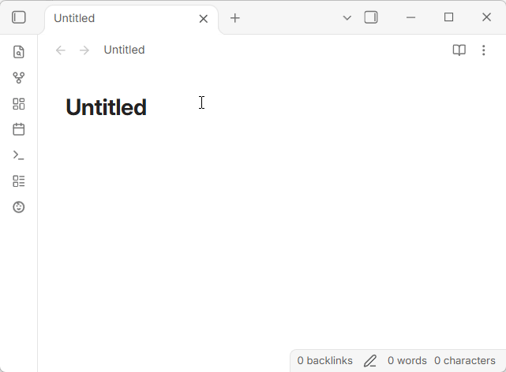

# Better Blockquote Editing

English | [日本語](README.ja.md)

Edit Obsidian callouts and blockquotes inline with the native Markdown editor. Edit their content and titles without worrying about the outer `>` markers, while preserving your theme's styling.




Supports Live Preview in Obsidian 1.14.4 and later.

## Usage

1. Add `https://github.com/uoFishbox/obsidian-better-blockquote-editing` to the [BRAT](https://github.com/TfTHacker/obsidian42-brat) plugin, then install and enable the plugin.
2. In Live Preview, move the cursor into a callout or blockquote to open the inline editor. You can also click or tap a callout's content or title to open the editor and place the caret at that position.
3. Edit as you would in a regular Markdown document.
4. Finish editing by pressing **Esc** or **Ctrl+Enter** (**Cmd+Enter** on macOS), clicking the close icon in the upper-right corner, or using the arrow keys to move the caret outside the editor.

- Edit callout titles inline with Obsidian's native Markdown editor, including link completion and formatting commands. Nested callouts and blockquotes are also supported.
- Click the icon in the upper-left corner of a callout to open the type picker. Search built-in types and aliases, or enter a custom type name.
- Use the arrow keys to move between the content and title or out of the block. Press **Enter** in the title to move to the content.
- Click another callout's content or title to sync your current edits and switch to it. If syncing is paused or an IME composition is in progress, the current editor stays open.

## Limitations

- Source mode, Reading view, and blockquotes inside list items are not supported.
- Change callout folding markers in Source mode.
- **If a problem occurs and syncing is paused, any unsynced content will not be saved to the original note. Copy the content from the modal that appears before closing it.**
- Full compatibility with other plugins is not guaranteed.

## Development

Use Node.js 22 or later.

```sh
npm ci
npm test
npm run build
```

Run `npm run dev` to rebuild automatically during development.

If the Obsidian CLI is available, enable the plugin and run the tests inside Obsidian:

```sh
npm run test:obsidian -- <vault-name>
npm run test:obsidian -- <vault-name> ./pane-focus.js
```

Before releasing, run both tests on the minimum version in `manifest.json` and the latest stable version. The focus test opens a split pane and a pop-out window in the test vault.
